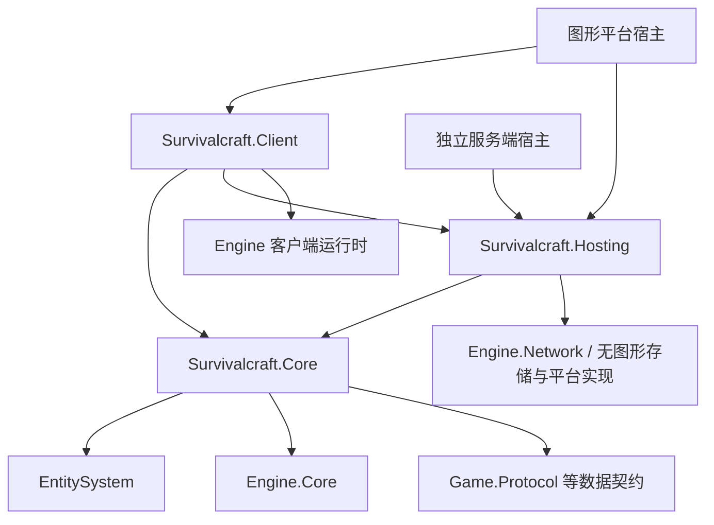

# 游戏逻辑核心分离方案

Core、Client、Hosting 与独立服务端入口已完成源码分离。本文记录实现边界、验证范围和持续验收要求。
当前运行模型见[结构与分层](Architecture.md)，启动对象职责见[启动会话](StartupSessions.md)。

## 目标与范围

将游戏运行逻辑提取为可独立编译和运行的公共核心。独立服务器与 GUI 开服使用同一套权威世界实现；
单机继续运行独立的权威世界和客户端世界，远程客户端也使用公共状态与预测算法。
共享核心代码不意味着共享同一个可变世界或跳过消息通信。

同时支持两种宿主产物：

- 图形程序：只提供 GUI 入口，装配客户端表现及需要的进程内权威世界。
- 独立服务端：引用核心与无图形服务端运行层，运行依赖及进程加载程序集排除综合应用、Client、图形 Engine 和窗口、GPU、音频设备后端。

迁移保持游戏规则、内容功能、存档引用和运行拓扑正确；已确认的缺陷单独记录和验证，
不以架构迁移为由悄悄改变玩法。本阶段不实现完整服务端移动输入模拟或反作弊，
也不设计新的模组分区、同步协议和公共 API 体系。

仓库尚未发布，没有外部模组生态。当前源码、内置内容、测试与少量内置模组一起调整，
不增加旧 API 门面、类型转发、兼容解析器或长期双轨路径。产品版本按现有开发规则保持；
开发期协议与文件兼容整数保持 `1`。

## 目标依赖图

当前项目与依赖方向如下。

- `Survivalcraft.Core`：实体、玩法、物理、地形状态与生成、电路、库存、配方、规则配置、
  保存模型、复制语义和公共预测算法。允许存在 Authority 与 Client 两个独立实例。
- `Survivalcraft.Client`：输入解释、视图、界面、模型、地形网格与绘制、音频、粒子、皮肤合成、
  客户端资源读取器及表现组件。客户端本地偏好属于这一侧或其宿主。
- `Survivalcraft.Hosting`：无图形世界装配、游戏连接与传输适配、监听与连接管理、存储实现、
  配置解析与保存、服务端管理入口、运行循环与关闭协调。客户端也可使用其中的连接能力。
- 宿主：选择模式与实例、创建有效启动上下文、安装能力、处理进程与平台生命周期。
  综合宿主和独立宿主不得复制服务器业务或各自实现一套世界装配。

先复用已独立的 Engine.Core、EntitySystem、Game.Protocol、Engine.Network；
不为目录整齐增加大量空项目或逐类接口。只在真实反向依赖处建立必要边界。
核心不得引用 Client、综合宿主或当前包含图形运行时的整个 Engine。
存储、时钟和配置等无图形能力需要重新归属或由宿主提供，不能通过一个全能宿主接口反向调用界面。
CPU 图像校验等能力如有服务端实际需求，可由相应基础设施使用 Engine.Media；
它不应成为将窗口和图形引擎重新引入核心的理由。

## 当前实现

公共规则、客户端表现与无图形宿主分别由独立程序集承载。综合应用与独立服务端复用 Hosting 的权威世界装配和生命周期，客户端通过独立工厂绑定表现资源。

| 边界 | 当前实现 | 归属 |
|---|---|---|
| [Survivalcraft.csproj](../Survivalcraft/Survivalcraft.csproj) | 装配 Core、Client 与 Hosting，处理应用导航与平台生命周期 | 综合应用 |
| [Block.cs](../Survivalcraft.Core/Blocks/Block.cs) 及派生类 | 规则和碰撞定义与视觉工厂分别注册 | 规则归 Core，视觉实现归 Client |
| [ClothingData.cs](../Survivalcraft.Core/Inventories/ClothingData.cs) | 数值与资源标识和 GPU 皮肤合成分别管理 | 数据归 Core，GPU 绑定归 Client |
| [SubsystemTerrain.cs](../Survivalcraft.Core/Subsystems/SubsystemTerrain.cs)、Sky 等 | 状态、生成与保存和网格、绘制分别实例化 | 规则归 Core，表现归 Client |
| [Entity.cs](../EntitySystem/Core/Entity.cs)、[Project.cs](../EntitySystem/Core/Project.cs) | 在类型解析与构造前按执行侧选择组成 | EntitySystem |
| [CharacterData.cs](../Survivalcraft.Core/Characters/CharacterData.cs) | 公共角色状态与本机视图、输入和出生界面分别持有 | 状态归 Core，表现归 Client |
| [GameWorldController.cs](../Survivalcraft.Hosting/World/GameWorldController.cs) | 统一权威加载、关闭和世界文件活动登记，应用另行装配客户端 | Hosting |
| [NetNode.cs](../Survivalcraft.Hosting/Network/NetNode.cs) | 物理节点、世界消息目录与规则处理使用同一实现，客户端效果处理在 Client | Hosting 与 Client |
| 配置与存档 | Client/Hosting 持有各自偏好，PreferenceStore 路由持久化，WorldProjectPersistence 保存权威世界 | 对应配置所有者与 Hosting |

依赖检查同时覆盖项目引用、解析后的程序集引用和服务端运行依赖。完整运行与产物验收继续遵循下方清单。

## 配置所有权

配置迁移与类型迁移同时实施。先分类字段，再决定对象和物理文件，不能先机械复制两份配置文件。
已有 Starter、RunningSetting、StartupRequest、SessionInfo、StartupContext 的职责与覆盖顺序继续遵守现有契约；
如需调整，必须同步修改两个平台的解析和文档，并用优先级测试证明。

| 类别 | 所有者 | 读取与修改 | 持久化与同步 |
|---|---|---|---|
| 世界规则 | 权威世界 | 服务端提交修改；客户端预测和显示读只读有效快照 | 保存在世界；首次连接、重连和有效修改后同步 |
| 服务端运行参数 | 服务端宿主 | 监听、容量、分发预算、管理接口等由宿主控制 | 实例/启动配置；仅必要事实下发客户端 |
| 本机偏好 | 客户端及其宿主 | 音量、画质、按键、灵敏度等本地修改 | 本机保存，不参与服务端规则计算 |
| 公共计算参数 | 逐项确定 | 影响玩法结果的由权威拥有；表现平滑参数可留本机 | 不允许双方独立默认后产生规则差异 |
| 启动和连接目标 | 对应宿主 | 按既有启动对象解析，不进入世界规则对象 | 保留当前恢复、临时覆盖和保存语义 |

每个字段的迁移清单必须列出：声明、所有读写点、所有者、默认值、校验、启动覆盖来源、
保存位置、修改权限、生效时机、同步对象和关闭/重连行为。
例如 CreativeDigTime、AutoJump、VisibilityRange 不能只按界面所在位置决定归属，
要逐个确认它们对玩法时序、控制辅助和服务端兴趣范围的真实影响。

世界时间、生命、体力、角色位置和连接状态属于运行状态，不塞入配置快照。
密码、凭据及管理令牌不得进入面向普通客户端的规则快照。
GUI 开服界面是编辑入口，不因同进程而直接修改权威配置对象。

## 内容和类型装配

### 方块与资源

方块逻辑保留碰撞形状、物理与材料性质、放置/破坏/掉落、电路等规则。
图标、网格生成、绘制、裂纹、碎屑和 GPU 初始化从逻辑基类公共签名移出。
客户端通过方块资源身份关联视觉定义与实现；优先复用已有稳定标识和数值映射，
不为每个简单方块创建独立接口，也不通过 Core 中的虚拟空绘制方法维持旧调用。

纹理、模型和声音的资源标识可以属于数据定义，Texture2D、Model、Shader 等运行时对象不属于核心。
逻辑数据和客户端资源分别注册、加载、释放；本地化文本也须区分服务器规则结果、
可传输的文本契约和客户端格式化，不由核心访问窗口或界面资源读取器。

### 实体与世界模板

建立明确的逻辑组成与客户端表现组成。选择必须发生在 RuntimeTypeResolver 和构造器之前。
Authority 装配只包含逻辑组件/Subsystem；Client 装配包含公共状态/预测组件及客户端表现。
同一公共组件需要两侧运行时，仍是两个独立实例，不能借程序集迁移合并世界状态。

最终结构不得依赖 IsOptional、忽略缺类或维护一套空客户端类型，让 独立服务器勉强通过加载。
逻辑快照和存档不携带客户端程序集限定类型名；内置模板、类型解析、实体基线、
保存与重载测试应一并更新。客户端临时场景对象不进入权威存档。

### 模组后置

本阶段冻结新的模组框架设计，不增加公共过渡 API、旧入口适配器或混合分区方案。
内置方块、模板、配方、电路及内容映射是游戏基础能力，不能因目前位于 Modding 目录而延期。
它们先按最终职责归属装配，再讨论未来模组如何接入同一边界。

通用内容包与 `.scpkg` 继续使用双方一致的格式和散列，可携带客户端模块 DLL 及客户端资产。服务端按执行侧装配规则与 CPU 内容，跳过客户端入口与模块加载。

旧加载器和钩子只做使最终依赖图成立的必要调整；已有混合 IModContext 不能作为 Core 的反向依赖。
现有少量内置模组随最终 API 一起调整，不承诺旧二进制兼容。
完整的模组运行分区、能力声明、包分发、同步与升级策略留到分离完成后统一设计。
第一阶段必须明确哪些现有内置模组行为作为功能基线，以及迁移期哪些扩展入口暂缓启用，
不能在实现中悄悄禁用或用临时门面伪装支持。

## 迁移阶段和完成门槛

| 阶段 | 交付内容 | 通过门槛 |
|---|---|---|
| M0 边界与基线 | 全量文件/公共签名依赖清单、配置字段清单、内置内容/模组功能清单、宿主能力图；记录当前关键场景 | 每个阻碍有最终归属；配置所有者明确；没有待保活的旧 API 兼容约定 |
| M1 底层能力与工程约束 | 确定项目名、目标框架、无图形基础能力归属；拆全局导入并建立引用方向检查 | Core 的允许依赖可独立构建；不靠空项目或排除绝大多数逻辑冒充核心迁移完成 |
| M2 公共数据与装配 | 角色数据/客户端会话、世界配置快照、组件与 Subsystem 按目标装配；解除具体 NetNode 与核心状态的循环 | 不加载 Client 程序集也能构造代表性逻辑实体和最小世界；真实配置读写/同步测试通过 |
| M3 方块和内容契约 | 方块规则/视觉绑定、内置内容注册、资源读取器及逻辑/客户端资源包划分 | 全部内置方块、配方、电路可在无图形世界注册和模拟；客户端能绑定完整视觉实现 |
| M4 混合 Subsystem 与业务迁移 | 地形/天空/天气等状态与表现、规则消息处理与客户端效果处理、存档和复制，迁移其余核心代码 | 真实世界加载、推进、地形生成、保存、重进和客户端连接均不需要 Client 或图形引擎 |
| M5 宿主与发布 | 统一 Hosting 世界入口；现有综合程序及独立服务端；更新 Bash/PowerShell 发布和包依赖 | 两种服务端宿主复用同一运行实现；独立服务端的依赖清单与实际加载排除客户端运行时 |
| M6 完整验证与删除过渡结构 | 跨宿主/平台验证、内置内容与少量内置模组必要迁移、测试归属和文档 | 验收清单全部有证据，旧反向引用/重复装配/兼容门面删除；才进入模组框架设计 |

阶段按依赖推进，允许局部工作交错；M0 中验证发现的依赖循环可能调整具体先后顺序。
日常开发保持版本不变，重建本地 SDK 沿用 canonical pre-build --refresh，不把打包隐藏进普通构建。
每个提交形成可解释的完整边界；大迁移可在开发分支积累，阶段内临时不可构建不是最终交付状态，
不得为保持每一步旧模组 API 可用而引入需要长期维护的中间框架。

服务端应用装配由 `Survivalcraft.Server.ServerStarter` 持有，Hosting 不包含具体可执行程序的入口。GUI 与服务端分别装配相同的核心能力，应用级服务和循环随各自宿主管理。服务端应用的停止、重启和语言测试位于 `Survivalcraft.Server.Test`。

## 验收清单

- Core 单独构建及单元测试不要求 Android 工作负载、窗口或 GPU/音频设备。
- Core 的公共签名、类型初始化和传递依赖不引用 Client、Engine.Graphics、Windowing、Widgets 等客户端能力。
- 依赖检查覆盖实际程序集与发布依赖图，不能只检查 using 文本；保留数学、颜色和不可变资源标识等合法基础数据。
- 独立服务端的运行依赖和实际进程加载排除综合应用、Client、图形 Engine 与 SDL/OpenAL/OpenGL 后端，
  能注册完整内置内容、加载世界、连续模拟、生成地形、保存退出、重进并接受真实客户端。通用包中的客户端模块与资产按执行侧保留为未加载内容。
- 独立服务器与 GUI 开服复用相同世界装配、规则、自动保存、错误处理和关闭实现。
- 单机继续是两个独立世界经进程内通信；GUI 开服本机与远程客户端的初始基线、增量和结果处理一致。
- 客户端预测及碰撞行为保持，地形预测不写权威格子；规则判定不因表现资源不可用而改变。
- 世界规则快照、本机偏好和宿主参数分开，验证默认值、覆盖顺序、运行中修改、权限、重连及持久化。
- 出生、首次开场、重连不重播、死亡重生、骑乘、战斗、库存/合成、电路发射器、资源加载和世界切换有代表性回归。
- Linux/Windows 综合宿主、Android 客户端、独立服务端的项目与发行入口完成对应检查。
- 两个平台的发布/打包脚本、NuGet 清单、模板和文档同步，不把构建输出或临时证据提交到源码。
- 内置模组功能与限制按 M0 基线逐项验证；新的模组框架方案作为后续任务，不在本次验收中虚称完成。

验证按改动比例选择。保留仍然有效的现有 Component 回归证据；
核心消息、模板装配、配置或保存边界变化时，重新运行其影响的真实场景。
不在每个文件移动后重复整套平台测试，也不能用少量模型构造测试替代完整内置内容装配。

## 验证范围

Core、Hosting 与综合应用均执行了对应测试。Linux 已运行单机双世界、GUI 开服和远程客户端场景，覆盖移动、库存、内置模组表现与交互、方块放置及保存。独立服务端已验证无图形启动、命令、世界保存和两套内置模组加载。项目引用、运行依赖和实际进程加载分别检查，通用包内的客户端模块保持未加载。

Linux 和 Windows 图形入口、Windows 独立服务端及四个 Android 项目已通过构建。Android 真机运行、Windows 本机运行及发行打包验证需分别记录，构建验证覆盖源码和依赖装配。具体验证记录由每次变更的测试结果和运行报告提供，维护文档保留职责与验收范围。

后续变更继续检查单机、本机客户端和远程客户端的消息与生命周期一致性。完整模组框架设计作为后续工作单独处理。
