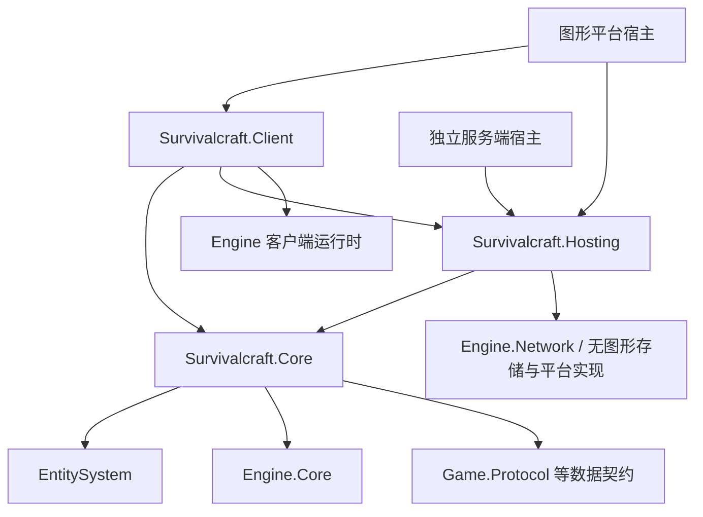

# 逻辑核心分离与验收

游戏规则、客户端表现和无图形宿主已经分离。独立服务器与 GUI 开服共用权威世界实现。单机也分别运行权威世界与客户端世界，通过进程内连接交换消息。

## 依赖边界

- **Core** 提供游戏规则、实体、玩法、地形生成、复制语义与预测算法。权威端和客户端分别持有自己的运行状态。
- **Client** 提供输入、视图、界面、网格、渲染、音频与客户端资源管理，可调用 Hosting 的连接和命令服务。
- **Hosting** 提供无图形世界装配、连接、存档、模组运行时与权威世界生命周期。图形应用和独立服务器在各自入口装配这些服务。

完整项目职责、构建依赖检查和源码入口见[结构与分层](Architecture.md#逻辑核心依赖边界)。

## 配置、内容与存档

- 世界规则由权威端持久化和修改，客户端使用同步的有效规则做预测和展示。监听与容量归服务端宿主，音量、画质和按键归客户端。启动参数与配置覆盖顺序见[启动会话](StartupSessions.md)。
- 方块规则与客户端视觉实现通过稳定资源标识关联。明确区分规则数据、可传输文本与客户端表现资源。内容注册和扩展入口见[模组开发](Modding.md)。
- 实体和子系统在解析类型、构造实例之前按执行侧选择组成。权威存档保存权威状态，客户端临时场景对象随表现世界释放。

## 验收清单

按改动影响选择验证场景，并记录实际通过的平台和入口。

- 检查 Core 能独立构建和测试。核对解析后的程序集引用和独立服务端的发布依赖，排除客户端程序集及窗口、GPU、音频设备后端。
- 涉及内容装配、存档或服务器生命周期时，用独立服务端验证内置内容与受影响的模组、世界加载、地形生成、持续模拟、保存退出、重进和客户端加入。
- 涉及消息、预测或双世界生命周期时，分别验证单机进程内连接、GUI 开服本机客户端及远端客户端。核对初始基线、后续增量及操作结果。
- 涉及玩法或内容时，选取受影响的出生、重生、骑乘、战斗、库存、合成、电路或世界切换场景。涉及配置时，检查默认值、覆盖顺序、权限、生效时机、持久化与重连。
- 涉及平台或发行时，验证对应的 Linux、Windows、Android 和独立服务端入口。Bash 与 PowerShell 脚本、NuGet 清单、模板和构建说明一起维护。构建结果与设备运行、发行物冒烟分别记录。
