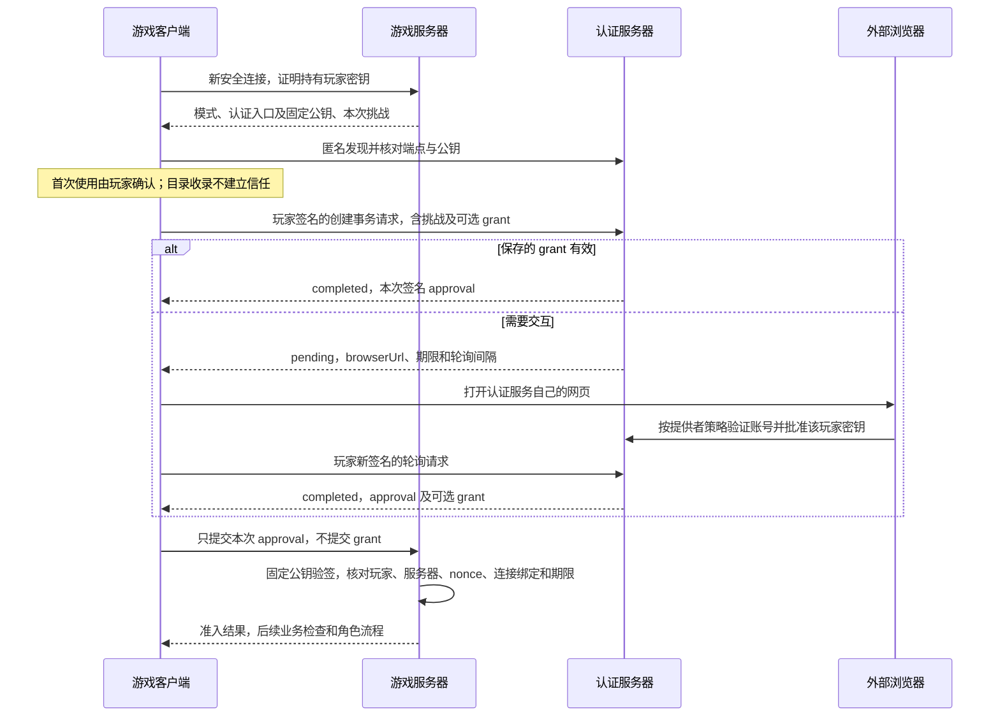

# 认证与外部准入协议

本文描述当前 `SCNET.Authentication.Protocol` 版本 **1** 的协议和游戏接入边界。
产品及 NuGet SemVer 与协议整数独立；当前仍未发布，不维护旧开发线格式。
参考服务运行方式见 [Authentication.Server](../../Authentication.Server/README.md)，
客户端配置与重启见 [启动会话](../StartupSessions.md#客户端认证服务与授权)，
服务收录和审核见 [ContentServer](../ContentServer.md#认证服务目录)。

## 职责与三种模式

玩家持有实例玩家私钥，地址由公钥导出；它证明当前操作者，而不是存档角色。
服务器在安全连接中固定操作者，角色、权限、队伍、存档封禁仍由游戏业务处理。
外部服务只批准准入，不创建或分配角色，也不修改存档认领状态。

| 模式 | 准入条件 | 交互 |
|---|---|---|
| 开放 | 持钥安全连接及游戏业务检查 | 自动提交本次挑战，不访问外部服务 |
| 服务器密码 | 相同持钥身份及本服务器密码 | 游戏遮蔽输入框，经加密游戏协议提交 |
| 外部认证 | 相同持钥身份及可信认证方的连接批准 | HTTPS 签名事务、提供者网页、轮询 |

客户端可在密码对话框中选择“在此实例记住密码”，默认不勾选。仅服务器接受后，将密码保存到当前实例的
`Config/Private/ServerCredentials.xml`，按已证明的服务器公钥身份关联，不按 IP 或域名复用。
下次连接同一服务器身份时自动提交；密码被拒绝后清除旧值并重新询问，不循环自动重试。
身份设置提供清除全部已保存服务器密码的入口，不影响身份密钥或外部认证 grant。
此文件沿用实例私有文件的设备信任边界，不使用系统密钥环，不写入存档或全局 Settings。
主动取消准入直接返回服务器列表；真实失败仍显示原因。

身份地址在常规界面保留 `scnet1` 前缀、其后的六位及末六位，中间用 `...` 省略；
复制、存储和协议始终使用完整值。身份详情和首次信任核对入口可查看完整地址，缩写不作为身份验证依据。

密码不是外部认证协议的一部分。认证方不持有游戏服务器密码；开放模式也不等于没有传输身份。
普通单机使用实例身份，跳过联机准入；GUI 先加载世界并开放监听，本机玩家随后通过与远端相同的准入策略，再恢复角色。
本机准入等待不会阻止服务器运行；取消或终止准入后的退出行为由本次进入流程决定：直接开始游戏则关闭世界，从服务器页加入则返回服务器页并保留监听。本机适配器不需要 UDP 回环连接。
Headless 没有可玩本地主机玩家。游戏服务器不向认证方注册，启动不访问认证服务，只需已配置的公开端点及可信公钥。

## 身份、公钥与信任

玩家、游戏服务器和认证方各自使用独立 P-256 密钥。公开地址为完整 RFC 7638 JWK SHA-256 指纹，
经 Engine.Core 的 `scnet` Bech32m 编码。协议地址使用规范小写形式，不能用姓名、目录 ID 或 URL 代替。
公开密钥为 DER SubjectPublicKeyInfo 的不带填充 base64url 编码，只接受一个完整 P-256 密钥。

发现端点匿名，不因 HTTPS 或收录审核而自动建立公钥信任。管理员配置认证公钥；客户端首次使用展示实际地址和指纹，
提供“登录并保存 / 仅此次登录 / 拒绝”。保存与登录分开，服务可以先安装而不登录。
ContentServer 只记录来源，不保存认证公钥或身份。客户端从不同来源发现同一公钥时视为同一认证身份；域名变更须确认，公钥变更视为另一认证方。
不自动信任轮换链、不把旧 grant 发给未确认端点，也不由服务器描述重新启用停用记录。
同一身份地址换域名仍是同一认证方，但变更访问入口仍须确认；同一域名换签名公钥则是另一身份。
HTTPS 证书证明访问入口及保护传输，认证签名公钥标识批准的签发者，两者不要求使用同一密钥。

## 外部认证流程

每次请求都由玩家私钥签名；认证服务器私钥只用于签发批准。任何一方都不应收到玩家私钥。
新进程、新连接仍需新的批准，保存的 grant 只用于减少网页交互，不复用原批准。
参考网页完成后显示返回提示；当前协议不要求本地回调端口、应用深链接、WSS 或浏览器自动切回游戏。

### 账号策略与持钥身份

认证服务内部的账号、手机号、邮箱或第三方账号不等于游戏玩家地址。
批准的 `sub` 必须是请求中已证明的玩家公钥地址，不能替换成提供者自己的账号 ID。
账号登录或密码找回也不能恢复丢失的玩家私钥、转移游戏角色或重置存档权限。

参考服务只提供管理员预置账号及密码登录，账号哈希由部署配置提供，封禁由管理命令执行。
它不提供公开注册、手机号/邮箱验证、自助找回或 ContentServer 内置认证。
第三方可以采用不同账号与准入策略，只需遵守同一签名事务和批准协议；不要求兼容 OAuth/OIDC，
也不要求游戏服务器向提供者注册。完整账号产品并非本协议的前置条件。

## HTTP 入口

所有客户端入口要求可信 HTTPS，不跟随重定向。`serviceUrl` 为以 `/` 结尾的绝对基址，
无 userinfo、query 或 fragment；公布的地址统一为 ASCII（IDN 主机为 Punycode，路径使用 URI 转义），路径相对它解析。反向代理子路径应由代理剥离，不改变协议签名目标。
请求和响应为 JSON，输出属性为 camelCase，枚举为 camelCase 字符串；枚举整数不接受。

| 方法和相对路径 | 请求/响应 |
|---|---|
| GET `.well-known/scnet-authentication` | 公开服务描述 |
| POST `v1/transactions` | 签名的创建事务数据 → 事务结果 |
| POST `v1/transactions/poll` | 签名的 `transactionId` → 事务结果 |
| POST `v1/transactions/cancel` | 签名的 `transactionId` → 事务结果 |
| POST `v1/grants/revoke` | 签名的 `grant` → 错误/成功结果 |

服务描述包含 `protocolVersion`（1）、`displayName`、`serviceUrl` 和 `publicKey`。
客户端核对请求的基址与返回值一致；已知服务还须核对固定指纹。发现变化时失败，不能覆盖本地信任。

POST 外层只有 `publicKey` 与 `proof`，即 `SignedAuthenticationRequest`。其中 `proof` 为 JWS compact JWT，
完整覆盖下表的请求声明。它不是 Authorization Bearer 头，也不是用户私钥。
轮询、取消、撤销都必须重新签名；认证方不能把仅知晓事务 ID 的客户端视为所有者。

| 请求 JWT 字段 | 含义 |
|---|---|
| `alg` / `typ`（header） | 固定 `ES256` / `scnet-auth-request+jwt` |
| `kid`（header，必需） | 必须等于请求签名者的完整主体地址；信任仍来自实际验签公钥 |
| `iss`、`sub` | 同一个请求签名者地址，且必须由所附公钥导出 |
| `aud` | 认证方公钥地址，只允许单个字符串 audience |
| `jti` | 新的 32 字节随机值，规范 base64url |
| `iat`、`nbf`、`exp` | 非负整数 Unix 秒，最长 60 秒 |
| `htm`、`htu` | `POST` 与准确的完整公开入口 URL |
| `data` | 本次操作的签名数据对象 |

只允许 `alg`、`typ`、`kid` 这三个 header 名称，拒绝 `jku`、`x5u`、内嵌替代密钥及其他 header。
拒绝非规范 base64url、重复 JSON 属性、非整数时间、多 audience 和不同用途的 token。
最多允许 `iat`/`nbf` 向未来偏差 5 秒；已过期不宽限。参考实现使用有界 replay cache 消费 `sub+jti` 至请求到期，
客户端网络重试必须生成新的请求 ID 和签名。

## 事务数据与响应

创建数据为 `purpose`、可选 `challenge`、可选 `grant`：

- `purpose=login` 用于提前登录，不携带挑战，也不应返回游戏批准。
- `purpose=join` 必须提供 `challenge`，其 `subject` 必须等于请求签名者。
- 有可用 grant 时直接携带；否则创建网页事务。服务决定注册、账号验证、Google 等具体 UI。

挑战包含 `subject`、`server`、`nonce`、`channelBinding`、`expiresAt`。
`server` 取自经过持钥证明的实际游戏对端，`channelBinding` 取自当前安全连接，而不是任意游戏数据字段。
nonce 与连接绑定都为 32 字节规范 base64url；挑战最长 600 秒。

| 事务结果字段 | 含义 |
|---|---|
| `transactionId` | 提供者生成的、不超过 128 字符的无控制字符 ID |
| `state` | `pending`、`completed`、`denied`、`cancelled`、`expired` |
| `expiresAt` | 事务绝对截止时间，Unix 秒，游戏客户端最多接受距当前 600 秒及 5 秒时钟偏差 |
| `pollAfterSeconds` | 建议轮询间隔，客户端接受 0–30，并至少等待一秒 |
| `browserUrl` | pending 时提供的同源 HTTPS 网页地址，主机与端口须匹配、禁止 userinfo、最多 4096 字符；不是轮询端点 |
| `grant`、`grantExpiresAt` | 可选长期授权及其绝对到期时间 |
| `approval` | join 完成时必须提供的本次游戏批准 |
| `error` | `none` 或明确错误分类 |

Pending 不能携带成功 grant、approval 或非 none 错误。轮询必须与原事务 ID、到期时间保持一致；
迟到、取消或离开当前流程的结果不能保存配置或进入游戏。网页完成不意味着游戏业务检查已通过。
轮询响应依靠 HTTPS；游戏批准本身另有认证方签名。
已创建事务的轮询遇到临时网络错误或单次 HTTP 超时时，客户端等待两秒后重试，仍受原事务及挑战期限约束；
不因此创建新事务、重新打开网页或替换固定公钥。移动端从浏览器返回游戏时若游戏传输已断开，
有效 grant 可接续当前加入，但必须重新建立安全连接并申请新批准，不能提交旧连接的批准。

参考网页使用 URL fragment 传递一次性网页秘密，读取后清除。提供者不得把可批准事务的秘密放入 HTTP 访问路径、
引用来源或日志；游戏不监听本地回调端口，不使用剪贴板或 WSS。
参考实现两秒轮询，预登录事务五分钟，join 截止时间取挑战截止时间；每主体最多八个事务、全局最多一千个。
事务及结果领取秘密驻留进程内，服务重启后失效；未到期 grant 状态单独持久化。
显式取消已完成参考事务也会撤销它新签发的 grant，不能把取消当作再次领取成功结果。

## Grant、期限与错误

JWT 只签名不加密，签名请求可能包含 grant；不得记录 proof、请求正文、网页秘密或用户密码。
Grant 是认证方的 opaque 值，不是玩家私钥，不交给游戏服务器，也不作为游戏数据包的身份声明。
使用它仍须由原玩家密钥签名，且认证方校验所属主体、期限、撤销及账号封禁。新连接必须用它换取新批准。
游戏客户端接受的 grant 字段最多 4096 字符，不允许控制字符；提供者应选择满足整个签名请求大小限制的表示。
参考实现只签发随机 base64url grant，持久化其 SHA-256 哈希，默认有效期 30 天，接受的自身 grant 输入不超过 128 字符。

错误结果为 `error` 与 `retryAfterSeconds`（缺省 0）。类型包括 `invalidRequest`、`invalidProof`、`expired`、
`denied`、`subjectBanned`、`grantExpired`、`grantRevoked`、`cancelled`、`notFound`、`rateLimited`、`unavailable`。
成功撤销返回 `error=none`。协议层 HTTP 非成功响应也应使用该结构；参考限流返回 429，协议/准入拒绝通常为 400。
HTTP 框架可能在协议处理前拒绝超大或格式错误的请求；无法解析的响应按失败处理，不作为认证通过或缓存过期。
客户端接受的错误重试提示为 0–3600 秒，事务轮询按其策略退避。

缓存授权仅在 `grantExpired` 或 `grantRevoked` 时清除并转网页；本地已过期也直接转网页。
封禁、不可用和限流不能伪装为过期，更不能降级开放或反复触发网页登录。
服务退出登录先清除本地授权，再尽力向原固定端点撤销；目录移除、停用、账号封禁和存档封禁是不同生命周期。
认证级封禁在下次申请批准生效，不实时踢出游戏；存档级封禁由游戏服务器处理。
临时“仅此次登录”只属于本进程内当前加入，不跨重启保存；重启后重新准入，只有已保存的有效 grant 可免网页登录。具体清理与恢复规则见启动会话文档。

## 游戏批准与会话

批准为 `typ=scnet-admission+jwt`、`alg=ES256` 的 JWS，认证方签名；header 的 `kid` 必须等于认证方的完整主体地址。
声明包含认证方 `iss`、玩家 `sub`、游戏服务器 `aud`、随机 `jti`、`iat`/`nbf`/`exp`、
`purpose=join`、挑战 `nonce` 及连接绑定 `cb`。最长 120 秒，同时不能晚于挑战截止时间。

游戏服务器以自己当前准入尝试的完整挑战调用 `AdmissionApprovalTokens.ValidateAsync`，核对公钥、用户、目标、用途、
连接、nonce 和期限；成功后消费该尝试，再执行封禁、重复在线、人数、角色恢复等检查。
不能在另一连接复用批准，也不能相信客户端数据包中的角色/玩家 ID 代替会话操作者。
批准不用随每个游戏包发送；会话中登记已验证主体，业务处理按操作者授权。

## 大小、传输与提供者实现

| 项目 | 当前上限/行为 |
|---|---|
| JWT compact 字符串 | 16384 字符；ASCII base64url，仅三个段，ES256 签名恰好 64 字节 |
| 认证 HTTPS 响应 | 32768 字节，含无 Content-Length 的流式响应 |
| SDK 请求超时 | 常规客户端请求 15 秒，独立发现请求 10 秒；流程仍受事务/挑战绝对期限约束 |
| 参考 HTTP 请求正文 | 32768 字节 |
| 游戏服务器准入 | 最多 32 个待认证连接、每来源 IP 最多 4 个；最多 2 个并行验证，排队与执行合计最多 32 个验证任务，连接断开不释放尚未完成任务的容量 |
| 服务显示名 / 基址 | 128 / 2048 字符；基址输入及规范 URI 均须满足上限 |

字段字符限制和整个编码消息限制须同时满足；UTF-8、JSON 转义和 base64url 会增加长度。
生成端也在发送前检查最终 JWT 长度，避免生成接收端必然拒绝的请求。
不得以截断 token、放宽验签、跟随重定向或替换固定公钥来兼容超限输入。
ContentServer 公开目录探测还有独立的公共 IP/DNS 固定、十秒和响应大小限制；这不是手动私有服务的地址限制。

第三方认证方可复用独立 NuGet 包的契约与验签能力，自行实现网页、账号策略、持久化、注册和审核。
请求签名、replay cache、事务主体隔离、固定公开 URL、grant 主体绑定、取消/过期与领取结果的持久化边界仍须遵守。
参考实现只适用于一个进程拥有一个私有数据目录，不包含多副本一致性、自动密钥轮换或游戏角色管理。

公开的 [互操作测试向量](../../Authentication.Protocol.Test/Fixtures/README.md) 包含由 OpenSSL 独立签署的
固定批准，以及由 Python 标准库计算的 JWK 指纹和 Bech32m 地址。向量不含私钥或真实授权；
验证时使用记录的固定时间，不应将其作为当前登录凭证。测试向量补充边界测试，不替代安全审查。

标准背景：[JWS RFC 7515](https://www.rfc-editor.org/rfc/rfc7515)、
[JWK 指纹 RFC 7638](https://www.rfc-editor.org/rfc/rfc7638)、
[JWT 最佳实践 RFC 8725](https://www.rfc-editor.org/rfc/rfc8725)。
