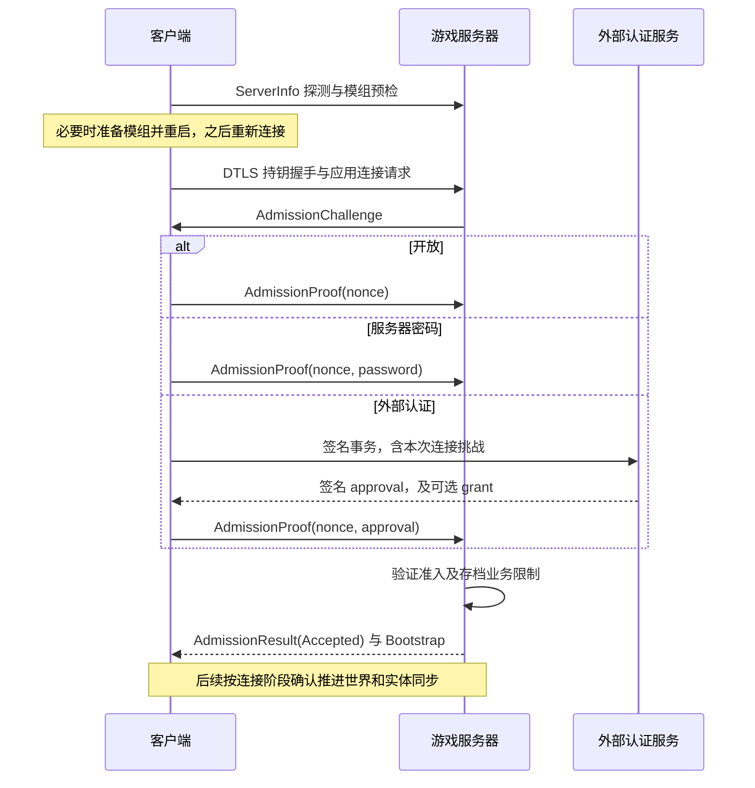

# 游戏联机协议

当前线格式由 `SCNET.Game.Protocol` 定义，协议整数为 `GameProtocol.CurrentVersion=1`，
与包的 SemVer 无关。协议库不依赖游戏运行时、图形窗口或具体传输宿主。

具体消息及其固定数字标签见 [IProtocolMessage](../../Game.Protocol/IProtocolMessage.cs) 的 MessagePack Union 声明；
字段顺序以各契约的数字 `Key` 为准。[ProtocolMessageCodec](../../Game.Protocol/Serialization/ProtocolMessageCodec.cs)
统一管理协议序列化配置与校验。
本文补充连接与准入、帧格式及授权边界，不重复全部状态同步字段。

## 分层与准备

游戏消息运行在[安全传输](TransportProtocol.md)之上。局域网和直接地址的 `ServerInfoPackage`
探测属于公开发现，用于预检版本、临时内容仓库、精确模组要求和短期世界信息，不证明游戏服务器可信。
信令或中继只决定实际路径，不能代替玩家准入。

客户端准备路径并核对、下载所需模组；需要切换 profile 时保存逻辑目标与模组配置并重启。
重启后重新准备、重新探测及重新认证，不恢复上一进程的批准或临时 grant。
服务器下发的临时仓库有数量、URL 长度和优先级限制，不修改本机永久仓库配置。

`ConnectionRequestPackage` 携带 `TmpToken`、协议整数、`ModDataHash` 和 `Magic`；当前 magic 为 `9421523`。
这些字段用于应用握手和准备关联，不是玩家私钥或认证凭证，不能用其代替已证明的连接身份。

## 准入顺序



准入期间的连接尚未成为可控制角色的在线玩家。人数、重复在线、存档封禁等检查仍由游戏服务器裁决；
网页批准本身不保证入场。GUI 主机使用相同策略执行本地玩家预认证；普通单机跳过联机准入，Headless 没有本地可玩玩家。

## 准入消息

| 消息 | 按序字段 |
|---|---|
| `AdmissionChallengePackage` | 模式、nonce、expiresAt、authorityName、authorityUrl、authorityPublicKey |
| `AdmissionProofPackage` | nonce string、password string、approval string、cancel bool |
| `AdmissionResultPackage` | nonce string、结果 AdmissionResultCode、retryAfterSeconds Int32 |

模式数值为 `Open=0`、`Password=1`、`External=2`。
非外部模式不得附带认证方资料。游戏挑战只传 nonce 和期限；外部 HTTPS 挑战的玩家、服务器身份及
`channelBinding` 由客户端从实际持钥连接补齐，不接受其他玩家同步资料提供的身份。

nonce 上限 43 字符，密码上限 1024，批准上限 16384；认证方名称、URL、公钥上限分别为 128、2048、256。
准入字符串使用 MessagePack UTF-8 字符串，读取前限制字节长度，解码后限制 UTF-16 字符数。
合法长度不表示语义合法，nonce、时间、签名和字段组合仍需准入处理器校验。

| 结果 | 枚举值 | 处理含义 |
|---|---|
| Accepted | 0 | 本次准入通过，后续仍按连接阶段同步 |
| IncorrectPassword | 1 | 重新询问；拒绝的已保存密码不循环自动提交 |
| ApprovalRejected | 2 | 批准无效，不能改用开放模式 |
| Expired | 3 | 本次尝试已过期 |
| RateLimited | 4 | 按重试提示等待 |
| Cancelled | 5 | 本次尝试取消 |
| Busy | 6 | 服务端容量不足 |
| Denied | 7 | 拒绝准入 |

`AdmissionResultCode` 的 CLR 底层类型为 `int`，以 MessagePack 整数编码；不规定为固定一字节线宽。
`retryAfterSeconds` 接受范围为 0–3600。用户主动取消应回到服务器列表，不再追加“已取消”错误弹窗；
真实过期、拒绝和网络故障仍显示原因。开放模式也必须证明持有玩家密钥，不等于匿名任意声明玩家 ID。
外部批准的签名、期限和连接绑定见[认证协议](AuthenticationProtocol.md)。

## 批量帧格式

`ProtocolPacketCodec` 的应用数据报布局如下；它不是原始 UDP 上最外层的 DTLS/LiteNetLib 封装。

```text
Int32LE frameLength
byte compression       0=None, 1=Deflate
Int32LE rawLength
bytes payload          未压缩或 Deflate 数据
```

`frameLength` 必须恰好等于其后剩余字节数；`rawLength` 上限为 64 MiB。
未压缩数据长度必须与声明一致；压缩数据必须恰好解出该长度，截断、超出、未知压缩码均失败。

解压后的 payload 是一个 MessagePack 消息数组，每项为 `[unionTag, fields]`。
`unionTag` 是协议显式声明的整数，`fields` 是按数字 `Key` 排列的数组；不传输 CLR 类型名称。
一批最多 1024 条消息。各具体消息携带自身需要的字段，发送方在入队前选择具体类型；
业务处理器可以按领域处理同一家族的多种消息，序列化器不根据业务操作标志选择字段。
嵌套变体同样使用显式 Union，集合、字典和二进制值使用 MessagePack 对应类型；
GUID 使用 MessagePack 标准 GUID 字符串编码，数学值由协议层格式化为固定宽度数组。

解码前按声明的契约检查字段数量、必填值、已知 Union、枚举、集合长度和最大 64 层深度，
随后执行协议语义校验。未知标签、截断、尾随数据或非法字段导致整个批次失败；不猜测或跳过。
MessagePack 依赖、格式化器及配置归属 `Game.Protocol`，`Engine.Core` 和 `Engine.Network`
不依赖这一游戏线格式。游戏、工具、命令参数和模组的类型化载荷使用同一协议配置。

Adaptive 压缩是发送优化，不改变消息含义；接收端必须接受当前定义的两种压缩码。
实际可发送的数据报预算还受路径与传输限制，不能将 64 MiB 解压上限理解为单个 UDP 可用长度。

## 同步与授权边界

`BootstrapPackage` 包含世界描述、连接 Epoch、方块映射、客户端名单、项目与材质数据。
后续阶段确认、初始世界快照、实体和地形同步见[网络复制](../NetworkReplication.md)及[地形分发](../TerrainDistribution.md)。

玩家身份地址、角色 `CharacterId`、临时 `ControllerSessionId` 和连接 Epoch 是不同标识：
公开角色资料不提供私钥，也不能让另一个连接获得该角色的控制权。
游戏处理器必须基于已验证的发送连接核对每个角色操作、命令和资源修改请求，不能只相信包内声明的玩家/角色 ID。
权限、队伍和存档封禁属于玩家，角色与其控制关系由游戏业务管理。

消息的可靠性及通道划分由 [NetworkChannel](../../Game.Protocol/NetworkChannel.cs) 和游戏发送策略共同决定。
`Game.Protocol` 编码值与快照，不读取世界或执行权限检查；外部批准不随每个游戏消息重复发送。
